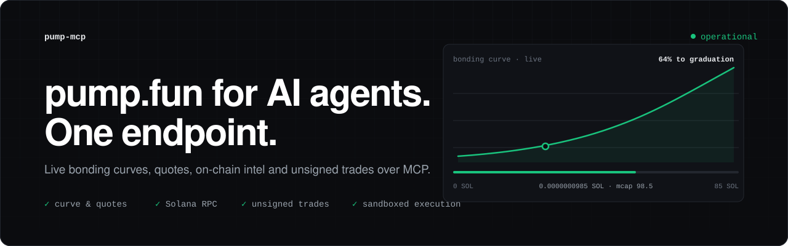
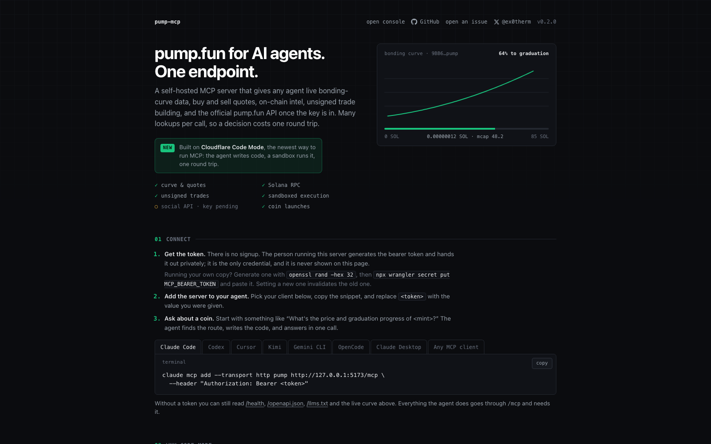
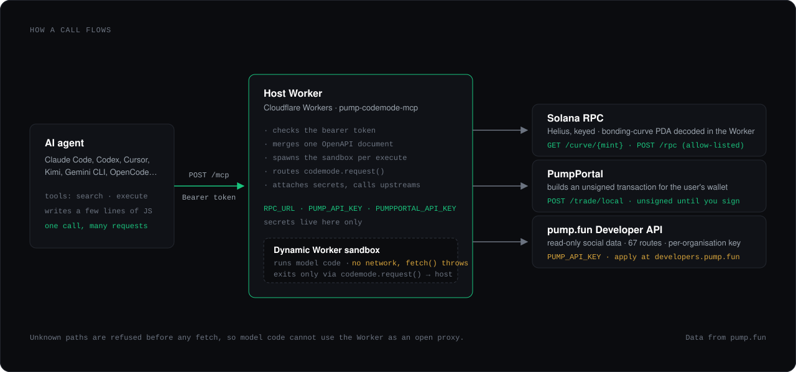

<p align="center"></p>

# pump-codemode-mcp

Self-hosted **Code Mode** MCP server for [pump.fun](https://docs.pump.fun), running on Cloudflare
Workers. Instead of one MCP tool per endpoint, agents get two tools, `search` and `execute`, and write
JavaScript against an OpenAPI document. The code runs in a sandboxed Dynamic Worker with no network
access; every API call comes back to the host Worker, which attaches credentials and forwards it to an
allow-listed upstream. Built with [`@cloudflare/codemode`](https://developers.cloudflare.com/agents/tools/codemode/)
and `agents/mcp`. MIT licensed. Data from pump.fun.

It ships with a web app at `/` (Svelte 5 + Vite, source in `web/`): a live bonding curve for a showcase
coin, connect snippets for Claude Code, Codex, Cursor, Kimi, Gemini CLI, OpenCode and Claude Desktop,
example questions with the code they run, and a token-gated playground that runs the real `execute`
tool. `/llms.txt` says the same for agents.

<p align="center"></p>

## Why Code Mode

The usual way to put an API in front of an agent is one MCP tool per endpoint. The model gets a list of
tool definitions, picks one, waits, reads the result back into its context, picks the next. pump.fun's
Developer API alone has 67 routes; add the on-chain, RPC and trading routes and that is a tool list most
clients handle badly, and every question that needs more than one lookup costs a round trip per lookup,
with every intermediate result flowing through the model on the way.

Code Mode turns that around. This server exposes two tools. `search` lets the model inspect one merged
OpenAPI document. `execute` takes a JavaScript function the model writes against it. That function runs
in a Dynamic Worker: a fresh V8 isolate spawned for that one call, with no network of its own, where
`fetch()` throws. The only way out is `codemode.request()`, which returns to the host Worker, where the
credentials live and where every path is checked against the route table before anything is fetched.
When the function returns, the isolate is discarded.

What that buys the person on the other end of the agent:

- **One question, one round trip.** "Check these 8 coins, rank them by graduation, quote 0.3 SOL on
  each" is eight curve reads. As tools, that is eight model turns, eight results read back, and a model
  doing the comparison by hand. As code it is one `Promise.all`, a `.sort()`, and a ten-line answer.
  Faster to the user, a fraction of the tokens, and no chance of a mis-copied number along the way.
- **The model only reads the answer.** Intermediate data stays in the sandbox. A long trade list is
  filtered down to the rows that matter before the model sees anything, and the ~6k-token cap on MCP
  responses stops being a wall. Anthropic measured the same pattern on a document-moving task:
  150,000 tokens through tool calls versus 2,000 through code execution, a 98.7% reduction.
- **Models are better at this.** Cloudflare's case for Code Mode is that models have seen enormous
  amounts of real JavaScript and very few real tool-call transcripts, so given a typed API they chain,
  loop and branch reliably, while given eighty tools they fumble. That is an argument from training
  data rather than a published benchmark, but it matches what we see in practice here.
- **The keys are unreachable.** The model's code cannot read `RPC_URL`, `PUMP_API_KEY` or the
  PumpPortal key, cannot open a socket, and cannot call a path outside the route table. Those are
  properties of the sandbox, not of a prompt asking the model to behave.
- **The whole surface, not a curated slice.** All 67 official routes plus curve, RPC and trade building
  are available, found on demand through `search`, instead of a subset squeezed into a tool list.
- **Isolation that is cheap enough to do every time.** Isolates start in milliseconds and use a few
  megabytes, so a sandbox per call is affordable in a way containers are not.

The same question, both ways:

| | One tool per endpoint | Code Mode, this server |
|---|---|---|
| Tool definitions in context | 70+ | 2 |
| "Rank 8 coins by graduation" | 8 model turns, 8 results read back | 1 turn, 1 result |
| A 10,000-row list | the model reads it, or it does not fit | code filters it, the model reads a summary |
| Where secrets live | often in tool arguments or the agent's env | host Worker only; the sandbox has no network |
| Adding a route | a new tool, a new schema, clients reload | the OpenAPI document grows, nothing else changes |

The trade-off is that running model-written code needs a real sandbox, and this server pays for that
with Cloudflare's Worker Loader, which is still marked experimental and needs the Workers Paid plan in
production. Further reading: Cloudflare's [Code Mode announcement](https://blog.cloudflare.com/code-mode/)
and [docs](https://developers.cloudflare.com/agents/tools/codemode/), Anthropic's
[Code execution with MCP](https://www.anthropic.com/engineering/code-execution-with-mcp), and the
[Model Context Protocol](https://modelcontextprotocol.io) specification.

## What it exposes

One merged OpenAPI document, routed per path:

| Routes | Upstream | Needs | Notes |
|---|---|---|---|
| **Official Developer API** (67 ops): `/users/*`, `/following/*`, `/callout/*`, `/posts/*`, `/pnl-leaderboard/*`, `/competitions/*`, `/user-positions/*`, `/user-trades/*`, `/portfolio-summary*`, `/moderation/*`, ... | `https://api.pump.fun/v1` (devnet: `api-devnet.pump.fun`) | `PUMP_API_KEY` (`pf_live_...`) | Read-only social data. Spec fetched from `https://docs.pump.fun/openapi.public.json` and cached 1h. Scopes, 2 rps / 50k per day per key. Error envelopes (`API_KEY_RATE_LIMITED`, `retryAfterMs`...) are passed through. |
| `GET /curve/{mint}` | Solana RPC, bonding-curve PDA decoded in-Worker (`src/curve.ts`, layout from the public IDL) | `RPC_URL` | Reserves, price, market cap, graduation progress, buy/sell quotes. Handles SOL-, USDC- and PUMP-quoted curves; Mayhem-mode coins get price but no quotes. |
| `POST /rpc` | Solana RPC, allow-listed methods only | `RPC_URL` | `getAccountInfo`, `getBalance`, `getTransaction`, `simulateTransaction`, `sendTransaction`, ... (`RPC_ALLOWED_METHODS`). |
| `POST /trade/local` | PumpPortal Local API | nothing | Returns an **unsigned** base64 transaction for the given wallet. PumpPortal takes 0.5%. |
| `POST /trade/lightning` | PumpPortal Lightning API | `PUMPPORTAL_API_KEY` | Disabled unless set. Moves funds from the PumpPortal-custodied wallet. |
| `GET /coins*`, `/trades/*`, `/candlesticks/*`, `/replies/*`, `/balances/*`, `/sol-price` | `frontend-api-v3.pump.fun` (unofficial, the website's API) | nothing | **Blocked from servers today**: pump.fun fronts it with a bot challenge, so Workers get `403 Just a moment...`. Kept for when that changes or for a mirror set via `PUMP_FRONTEND_API_ORIGIN`. |

Secrets never reach the sandbox: they are attached in `src/upstreams.ts` only. Unknown paths are refused
before any fetch, so model code cannot use the Worker as an open proxy, and `fetch()` inside the sandbox throws.

<p align="center"></p>

### Why not the stock pump.fun MCP server?

pump.fun runs one at `https://mcp.pump.fun/mcp` (28 tools, each exactly one API call, stateless, your
`pf_live_` key as bearer). Use it if you only need the social API. This server is for when you want:
the whole 67-route surface instead of 28 tools; filtering and joins in code so a multi-step question
costs one tool call and a few hundred output tokens instead of N round trips; and the on-chain,
RPC and trading routes next to it, under one token your agents already hold.

## Get a pump.fun key

Sign in at [developers.pump.fun](https://developers.pump.fun) with your pump.fun account, apply
(business name, email, use case, scopes), verify the email, wait for approval, then create a key.
It is shown once. Until approved, everything except the official routes works.

## Run locally

```sh
cp .dev.vars.example .dev.vars        # MCP_BEARER_TOKEN; RPC_URL for chain reads; PUMP_API_KEY when you have one
bun install
bun run build                         # builds the web app into ./dist (wrangler serves it)
bun run dev                           # http://localhost:8790  (web app at /, MCP at /mcp)
bun run dev:web                       # optional: Vite with hot reload at :5173, proxying the Worker routes to :8790
bun test && bun run typecheck         # Worker tests + tsc, then svelte-check
```

Connect Claude Code:

```sh
claude mcp add --transport http pump http://localhost:8790/mcp --header "Authorization: Bearer <MCP_BEARER_TOKEN>"
```

Claude Desktop / Cursor: `{"mcpServers":{"pump":{"url":"http://localhost:8790/mcp","headers":{"Authorization":"Bearer <MCP_BEARER_TOKEN>"}}}}`.

Example `execute` body the model writes:

```js
async () => {
  const mint = "9BB6NFEcjBCtnNLFko2FqVQBq8HHM13kCyYcdQbgpump";
  const curve = await codemode.request({ method: "GET", path: `/curve/${mint}`, query: { buyAmount: 0.5 } });
  const holders = await codemode.request({ method: "GET", path: `/mint-positions/${mint}` }); // official, needs key
  const tx = await codemode.request({
    method: "POST", path: "/trade/local",
    body: { publicKey: WALLET, action: "buy", mint, amount: 0.5, denominatedInSol: true, slippage: 10, priorityFee: 0.0005, pool: "auto" },
  });
  return { quoteAsset: curve.quote.symbol, price: curve.priceInQuote, topHolders: holders.slice(0, 5), unsignedTx: tx.transaction };
}
```

## Deploy

```sh
npx wrangler login                        # or CLOUDFLARE_API_TOKEN / CLOUDFLARE_ACCOUNT_ID
wrangler secret put MCP_BEARER_TOKEN      # required; /mcp answers 503 without it
wrangler secret put PUMP_API_KEY          # pf_live_... (optional until approved)
wrangler secret put RPC_URL               # keyed Helius URL; enables /curve and /rpc
wrangler secret put PUMPPORTAL_API_KEY    # optional; enables /trade/lightning
bun run deploy                            # vite build, then wrangler deploy
```

`wrangler.toml` deploys to a Workers Custom Domain (`routes = [{ pattern = "...", custom_domain = true }]`);
change the pattern to your own hostname or set `workers_dev = true` for a `*.workers.dev` URL. Set
`SHOWCASE_MINT` (a plain var) to any live pump.fun mint and the web app draws its real curve on load
through `GET /api/showcase`, a public read of that one mint cached for 20 seconds. Leave it empty for a
static illustration.

Worker Loader bindings (`[[worker_loaders]]`) need the Workers Paid plan in production; `wrangler dev`
runs them locally for free. Devnet: set `PUMP_API_ORIGIN = "https://api-devnet.pump.fun/v1"`. To serve
only the non-official routes set `PUMP_OPENAPI_URL = ""`. The bundle is ~5 MB raw / ~1 MB gzip (`agents/mcp`).

## Terms you are bound by

Your `pf_live_` key makes you the licensee under the
[pump.fun Developer API Terms](https://docs.pump.fun/terms/) (updated 2026-10-22). The ones that shape
how to run this server:

- Keys are per organisation and may not be shared, sublicensed or made available to third parties (6.4).
- You may not offer a service that gives third parties programmatic access to API data (8.3b). Run this
  for your own organisation's agents and applications, behind your own `MCP_BEARER_TOKEN`; do not
  publish the endpoint.
- Agents may retrieve data through MCP to answer a request but not retain it for AI training (8.3e).
  This server stores nothing; the only cache is the public OpenAPI document.
- Cache API data for at most 24 hours (8.7); show "Data from pump.fun" to end users (10.3).
- Honour rate-limit and `Retry-After` headers; no spreading load across keys (7.2).

The on-chain, RPC and PumpPortal routes are outside those terms. PumpPortal has its own.

## Contributing

Open an [issue](https://github.com/ex0th3rmic/pump-mcp/issues) for questions, bugs or ideas; the
templates ask for what is needed. Pull requests are welcome, see [CONTRIBUTING.md](CONTRIBUTING.md)
for setup and the ground rules (tests first for Worker changes, nothing widens the sandbox without a
refusal test, examples must run as written).

## Usage stats

With an Analytics Engine dataset bound as `ANALYTICS` (see `wrangler.toml`), the Worker counts page
views and MCP calls by tool name, nothing else: no IPs, no tokens, no code. Query it in the Cloudflare
dashboard (Analytics Engine → SQL) or with the SQL API:

```sql
SELECT blob1 AS kind, blob2 AS what, SUM(_sample_interval) AS n
FROM pump_mcp_events
WHERE timestamp > NOW() - INTERVAL '7' DAY
GROUP BY kind, what ORDER BY n DESC
```

## Brand

`docs/logo.svg` is the mark (dark) and `docs/logo-green.svg` the green colorway, both 1024×1024 with
PNG exports at 1024 and 512 (`docs/logo-*.png`) for avatars, social previews or a token image.
`docs/banner.svg` is the README header and `docs/x-header.svg` / `.png` the 1500×500 X profile header.
Green is `#19c37d` on `#0b0c0f`.

## Layout

- `src/index.ts` - Worker entry: `/health`, `/openapi.json`, `/llms.txt`, `/api/showcase`, bearer-gated `/mcp`, static assets for the rest. Builds `openApiMcpServer` with a `DynamicWorkerExecutor` on `env.LOADER`.
- `src/official.ts` - fetches/merges the official OpenAPI document and matches its path templates.
- `src/spec.ts` - the non-official routes as OpenAPI 3.1.
- `src/upstreams.ts` - host-side `request()` router: route table, validation, secret injection, binary-to-base64 for transactions.
- `src/curve.ts` - bonding-curve PDA derivation (noble ed25519 + sha256) and Borsh decode per the IDL, quotes.
- `web/` - the web app (Svelte 5). `vite build` writes it to `dist/`, which `[assets]` in `wrangler.toml` serves.
- `test/` - `bun test`; upstreams are exercised with an injected `fetch`.

## Caveats

- Code Mode is marked experimental by Cloudflare; `@cloudflare/codemode` and `agents` are pinned.
- Final MCP responses are truncated around 6k tokens; the tool description tells the model to filter in code.
- The frontend-API routes are best effort and unofficial.
