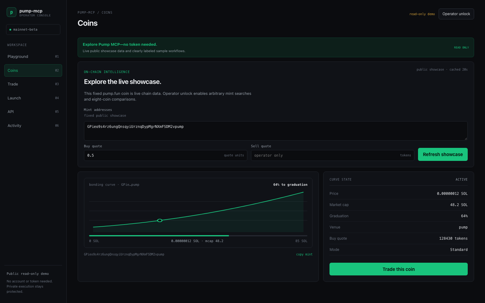
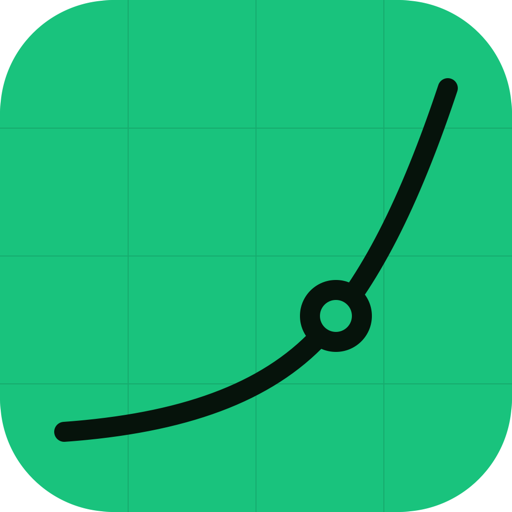
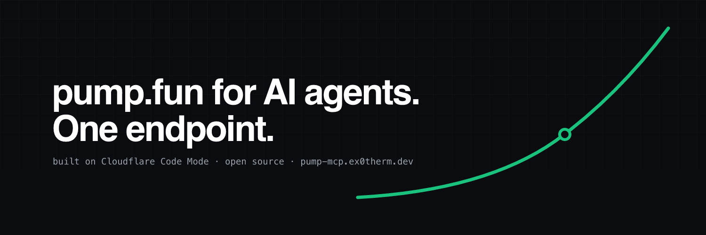

<p align="center">
  <picture>
    <source media="(prefers-color-scheme: dark)" srcset="docs/logo-green-512.png">
    
  </picture>
</p>

<p align="center"></p>

<p align="center">
  <a href="https://github.com/ex0th3rmic/pump-mcp/actions/workflows/ci.yml"></a>
  <a href="LICENSE"></a>
  <a href="https://developers.cloudflare.com/agents/tools/codemode/"></a>
  <a href="https://modelcontextprotocol.io"></a>
  <a href="https://pump-mcp.ex0therm.dev"></a>
  <a href="https://x.com/ex0therm"></a>
</p>

<p align="center">
  <a href="https://pump-mcp.ex0therm.dev"><b>Website</b></a> ·
  <a href="#quickstart">Quickstart</a> ·
  <a href="#why-code-mode">Why Code Mode</a> ·
  <a href="#configuration">Configuration</a> ·
  <a href="#roadmap">Roadmap</a> ·
  <a href="CONTRIBUTING.md">Contributing</a> ·
  <a href="https://github.com/ex0th3rmic/pump-mcp/issues/new/choose">Open an issue</a>
</p>

# pump-mcp

Self-hosted **Code Mode** MCP server for [pump.fun](https://docs.pump.fun), running on Cloudflare
Workers. Instead of one MCP tool per endpoint, agents get two tools, `search` and `execute`, and write
JavaScript against an OpenAPI document. The code runs in a sandboxed Dynamic Worker with no network
access; every API call comes back to the host Worker, which attaches credentials and forwards it to an
allow-listed upstream. Built with [`@cloudflare/codemode`](https://developers.cloudflare.com/agents/tools/codemode/)
and `agents/mcp`. MIT licensed. Data from pump.fun.

It ships with a web app at `/` and an operator console at `/app` (Svelte 5 + Vite, source in `web/`).
The landing page has a live showcase curve, client snippets, and runnable examples. The console adds
coin comparison, Wallet Standard-signed trades and launches, an API inspector, and activity. `/llms.txt`
describes the server for agents.

<p align="center"></p>

## Contents

- [Features](#features)
- [Web console](#web-console)
- [Quickstart](#quickstart)
- [Why Code Mode](#why-code-mode)
- [What it exposes](#what-it-exposes)
- [Configuration](#configuration)
- [Run locally](#run-locally)
- [Deploy](#deploy)
- [Usage stats](#usage-stats)
- [Terms you are bound by](#terms-you-are-bound-by)
- [Roadmap](#roadmap)
- [FAQ](#faq)
- [Contributing](#contributing)
- [Brand](#brand)
- [Project layout](#project-layout)
- [Caveats](#caveats)
- [Acknowledgements](#acknowledgements)
- [License](#license)

## Features

- **Two tools, the whole API.** `search` over one merged OpenAPI document and `execute` for code the
  model writes against it. 67 official pump.fun routes plus chain reads and trade building, found on
  demand instead of squeezed into a tool list.
- **One round trip per question.** The agent's code loops, filters and joins inside the sandbox; the
  model reads only the answer.
- **Keys the model can't reach.** The sandbox has no network and no environment. Secrets are attached in
  the host Worker, and unknown paths are refused before any fetch.
- **Chain reads with no middleman.** Bonding curves decoded straight from Solana: price, market cap,
  graduation progress, buy and sell quotes, for SOL-, USDC- and PUMP-quoted coins.
- **Non-custodial trades on pump.fun's own SDK.** Buy, sell and create are built in the Worker with
  [`@pump-fun/pump-sdk`](https://www.npmjs.com/package/@pump-fun/pump-sdk), on the curve or on PumpSwap
  after graduation, and come back unsigned for the caller's wallet. No middleman, no extra fee.
- **Coin launches from the agent.** `/metadata` pins the image and metadata to IPFS; `/trade` create
  returns a transaction the server's fresh mint has already signed, so only the creator signs.
- **A web app, operator console, and an `llms.txt`.** Connect snippets, a Code Mode playground, coin
  comparison, wallet-signed trades and launches, an API inspector, and a plain-text description for agents.
- **Privacy-respecting usage counts.** Optional Analytics Engine counts of page views and tool calls by
  name. No IPs, tokens or code.

## Web console

Open `/app` for a **public read-only demo**—no token, signup, or cookie. Visitors get plain-English Help with diagrams, the fixed live `/api/showcase` curve, clearly labeled sample playground results and trade/launch workflows, the OpenAPI inspector, and deployment health. Demo mode makes no `/mcp` requests and cannot pin, build, sign, or broadcast.

**Operator unlock** enables arbitrary curve reads and real actions with the deployment's `MCP_BEARER_TOKEN`. The token is kept in `sessionStorage` for the current tab session and is cleared by **Lock session**, returning the console to demo mode.

- **Help:** learn what Pump MCP does, which mode to use, what tokens and wallets mean, and how bonding curves and transactions work through plain-English explanations and accessible diagrams at `/app/help`.
- **Playground:** run curated sample results in demo mode or editable JavaScript through the real Code Mode `execute` tool as an operator. Natural-language interaction stays in the connected AI client.
- **Coins:** view the live public showcase, or inspect and compare up to eight arbitrary mints as an operator.
- **Trade:** inspect the read-only workflow, or connect a Wallet Standard-compatible wallet to build, simulate, explicitly sign, and submit real transactions as an operator.
- **Launch:** inspect the launch lifecycle, or explicitly pin metadata and build a create with an optional developer buy as an operator.
- **API and activity:** search the merged OpenAPI document, copy execute templates, inspect deployment health, and review in-memory operation history. Tokens, source code, transaction payloads, and full responses are not recorded.

Every operator transaction follows `preview → simulate → explicit wallet signature → submit → confirmed / failed / expired / not-found`. Changing an input or wallet makes a preview stale. Simulation does not guarantee inclusion, and the console never blindly rebroadcasts an uncertain transaction. Private keys never enter the browser app or Worker.



## Quickstart

**Connect to a running server.** You need its MCP URL and a bearer token from whoever runs it; there
is no signup. With Claude Code:

```sh
claude mcp add --transport http pump https://<host>/mcp --header "Authorization: Bearer <token>"
```

The web app at `https://<host>/` has the exact snippet for Codex, Cursor, Kimi, Gemini CLI, OpenCode,
Claude Desktop and plain HTTP. Then ask the agent about any pump.fun coin.

**Run your own.** Requires [Bun](https://bun.sh), a Cloudflare account on the Workers Paid plan (for
the Worker Loader binding) and, for chain reads, a Solana RPC URL such as a keyed Helius endpoint.

```sh
git clone https://github.com/ex0th3rmic/pump-mcp && cd pump-mcp
bun install
openssl rand -hex 32                      # your bearer token; keep it
npx wrangler login
npx wrangler secret put MCP_BEARER_TOKEN  # paste the token
npx wrangler secret put RPC_URL           # paste your RPC URL
bun run deploy
```

Change the custom-domain `pattern` in `wrangler.toml` to your own hostname first, or set
`workers_dev = true` to deploy to a `*.workers.dev` URL. See [Deploy](#deploy) for the rest.

## Why Code Mode

The usual way to put an API in front of an agent is one MCP tool per endpoint. The model gets a list of
tool definitions, picks one, waits, reads the result back into its context, picks the next. pump.fun's
Developer API alone has 67 routes; add the on-chain, RPC and trading routes and that is a tool list most
clients handle badly, and every question that needs more than one lookup costs a round trip per lookup,
with every intermediate result flowing through the model on the way.

Code Mode turns that around. This server exposes two tools. `search` lets the model inspect one merged
OpenAPI document. `execute` takes a JavaScript function the model writes against it. That function runs
in a Dynamic Worker: a fresh V8 isolate spawned for that one call, with no network of its own, where
`fetch()` throws. The only way out is `codemode.request()`, which returns to the host Worker, where the
credentials live and where every path is checked against the route table before anything is fetched.
When the function returns, the isolate is discarded.

What that buys the person on the other end of the agent:

- **One question, one round trip.** "Check these 8 coins, rank them by graduation, quote 0.3 SOL on
  each" is eight curve reads. As tools, that is eight model turns, eight results read back, and a model
  doing the comparison by hand. As code it is one `Promise.all`, a `.sort()`, and a ten-line answer.
  Faster to the user, a fraction of the tokens, and no chance of a mis-copied number along the way.
- **The model only reads the answer.** Intermediate data stays in the sandbox. A long trade list is
  filtered down to the rows that matter before the model sees anything, and the ~6k-token cap on MCP
  responses stops being a wall. Anthropic measured the same pattern on a document-moving task:
  150,000 tokens through tool calls versus 2,000 through code execution, a 98.7% reduction.
- **Models are better at this.** Cloudflare's case for Code Mode is that models have seen enormous
  amounts of real JavaScript and very few real tool-call transcripts, so given a typed API they chain,
  loop and branch reliably, while given eighty tools they fumble. That is an argument from training
  data rather than a published benchmark, but it matches what we see in practice here.
- **The keys are unreachable.** The model's code cannot read `RPC_URL`, `PUMP_API_KEY` or
  `PINATA_JWT`, cannot open a socket, and cannot call a path outside the route table. Those are
  properties of the sandbox, not of a prompt asking the model to behave.
- **The whole surface, not a curated slice.** All 67 official routes plus curve, RPC and trade building
  are available, found on demand through `search`, instead of a subset squeezed into a tool list.
- **Isolation that is cheap enough to do every time.** Isolates start in milliseconds and use a few
  megabytes, so a sandbox per call is affordable in a way containers are not.

The same question, both ways:

| | One tool per endpoint | Code Mode, this server |
|---|---|---|
| Tool definitions in context | 70+ | 2 |
| "Rank 8 coins by graduation" | 8 model turns, 8 results read back | 1 turn, 1 result |
| A 10,000-row list | the model reads it, or it does not fit | code filters it, the model reads a summary |
| Where secrets live | often in tool arguments or the agent's env | host Worker only; the sandbox has no network |
| Adding a route | a new tool, a new schema, clients reload | the OpenAPI document grows, nothing else changes |

The trade-off is that running model-written code needs a real sandbox, and this server pays for that
with Cloudflare's Worker Loader, which is still marked experimental and needs the Workers Paid plan in
production. Further reading: Cloudflare's [Code Mode announcement](https://blog.cloudflare.com/code-mode/)
and [docs](https://developers.cloudflare.com/agents/tools/codemode/), Anthropic's
[Code execution with MCP](https://www.anthropic.com/engineering/code-execution-with-mcp), and the
[Model Context Protocol](https://modelcontextprotocol.io) specification.

## What it exposes

One merged OpenAPI document, routed per path:

| Routes | Upstream | Needs | Notes |
|---|---|---|---|
| **Official Developer API** (67 ops): `/users/*`, `/following/*`, `/callout/*`, `/posts/*`, `/pnl-leaderboard/*`, `/competitions/*`, `/user-positions/*`, `/user-trades/*`, `/portfolio-summary*`, `/moderation/*`, ... | `https://api.pump.fun/v1` (devnet: `api-devnet.pump.fun`) | `PUMP_API_KEY` (`pf_live_...`) | Read-only social data. Spec fetched from `https://docs.pump.fun/openapi.public.json` and cached 1h. Scopes, 2 rps / 50k per day per key. Error envelopes (`API_KEY_RATE_LIMITED`, `retryAfterMs`...) are passed through. |
| `GET /curve/{mint}` | Solana RPC, bonding-curve PDA decoded in-Worker (`src/curve.ts`, layout from the public IDL) | `RPC_URL` | Reserves, price, market cap, graduation progress, buy/sell quotes. Handles SOL-, USDC- and PUMP-quoted curves; Mayhem-mode coins get price but no quotes. |
| `POST /rpc` | Solana RPC, allow-listed methods only | `RPC_URL` | `getAccountInfo`, `getBalance`, `getTransaction`, `simulateTransaction`, `sendTransaction`, ... (`RPC_ALLOWED_METHODS`). |
| `POST /trade` | Built in-Worker with pump.fun's official SDK from live chain state | `RPC_URL` | Buy, sell or create as an **unsigned** base64 v0 transaction for the given wallet. Curve or PumpSwap is picked automatically; sells take `"100%"`. Create generates the mint server-side and pre-signs with it. Create with a dev buy needs `LOOKUP_TABLES`. `/trade/local` is a deprecated alias. |
| `POST /metadata` | IPFS via Pinata | `PINATA_JWT` | Pins a new coin's image (inline data URL, 2 MB max) and metadata JSON; returns the `uri` create takes. Never fetches URLs. |
| `GET /coins*`, `/trades/*`, `/candlesticks/*`, `/replies/*`, `/balances/*`, `/sol-price` | `frontend-api-v3.pump.fun` (unofficial, the website's API) | nothing | **Blocked from servers today**: pump.fun fronts it with a bot challenge, so Workers get `403 Just a moment...`. Kept for when that changes or for a mirror set via `PUMP_FRONTEND_API_ORIGIN`. |

Secrets never reach the sandbox: they are attached in `src/upstreams.ts` only. Unknown paths are refused
before any fetch, so model code cannot use the Worker as an open proxy, and `fetch()` inside the sandbox throws.

<p align="center"></p>

Unauthenticated routes, for people and agents: `GET /` (web app), `GET /health`, `GET /openapi.json`,
`GET /llms.txt` and `GET /api/showcase`. Everything the agent does goes through `POST /mcp`.

### Why not the stock pump.fun MCP server?

pump.fun runs one at `https://mcp.pump.fun/mcp` (28 tools, each exactly one API call, stateless, your
`pf_live_` key as bearer). Use it if you only need the social API. This server is for when you want:
the whole 67-route surface instead of 28 tools; filtering and joins in code so a multi-step question
costs one tool call and a few hundred output tokens instead of N round trips; and the on-chain,
RPC and trading routes next to it, under one token your agents already hold.

## Configuration

Secrets are set with `npx wrangler secret put <NAME>`; plain vars live in `wrangler.toml` under `[vars]`.
For local development put both in `.dev.vars` (see `.dev.vars.example`).

| Name | Kind | Required | What it does |
|---|---|---|---|
| `MCP_BEARER_TOKEN` | secret | yes | The one credential clients send to `/mcp`. Without it `/mcp` answers 503. |
| `RPC_URL` | secret | for chain reads and trades | Solana RPC endpoint. Enables `/curve`, `/rpc`, `/trade` and the showcase curve. |
| `PUMP_API_KEY` | secret | for official routes | `pf_live_...` key from [developers.pump.fun](https://developers.pump.fun). |
| `PINATA_JWT` | secret | for `/metadata` | Pinata API JWT used to pin new coins' images and metadata to IPFS. |
| `LOOKUP_TABLES` | var | for create + dev buy | Address lookup table(s) the operator created with `bun run lookup-table`. |
| `IPFS_GATEWAY` | var | no | Gateway prefix for the links `/metadata` returns. Defaults to `https://ipfs.io/ipfs/`. |
| `SHOWCASE_MINT` | var | no | Mint whose live curve the web app draws through `/api/showcase`. Empty shows a sample. |
| `PUMP_OPENAPI_URL` | var | no | Official spec URL. Set to `""` to serve only the non-official routes. |
| `PUMP_API_ORIGIN` | var | no | Official API origin; `https://api-devnet.pump.fun/v1` for devnet. |
| `RPC_ALLOWED_METHODS` | var | no | Comma-separated JSON-RPC methods the sandbox may call through `/rpc`. |
| `SOLANA_CLUSTER` | var | no | `mainnet-beta` (default) or `devnet`; console label and explorer cluster. Must match `RPC_URL`. |
| `PUMP_FRONTEND_API_ORIGIN` | var | no | Origin for the unofficial frontend-API routes, or a mirror of it. |
| `LOADER` | binding | yes | `[[worker_loaders]]`: spawns the sandbox. Needs Workers Paid in production. |
| `ASSETS` | binding | no | `[assets]`: serves the built web app from `dist/`. |
| `ANALYTICS` | binding | no | `[[analytics_engine_datasets]]`: usage counts. Remove the block to record nothing. |

## Run locally

```sh
cp .dev.vars.example .dev.vars        # MCP_BEARER_TOKEN; RPC_URL for chain reads; PUMP_API_KEY when you have one
bun install
bun run build                         # builds the web app into ./dist (wrangler serves it)
bun run dev                           # http://localhost:8790  (web app at / and /app, MCP at /mcp)
bun run dev:web                       # optional: Vite with hot reload at :5173, proxying the Worker routes to :8790
bun test && bun run typecheck         # Worker/web tests + tsc, then svelte-check
bunx playwright install chromium
bun run test:e2e                      # browser console flows with mocked MCP and wallet
```

Connect Claude Code:

```sh
claude mcp add --transport http pump http://localhost:8790/mcp --header "Authorization: Bearer <MCP_BEARER_TOKEN>"
```

Claude Desktop / Cursor: `{"mcpServers":{"pump":{"url":"http://localhost:8790/mcp","headers":{"Authorization":"Bearer <MCP_BEARER_TOKEN>"}}}}`.

Example `execute` body the model writes:

```js
async () => {
  const mint = "9BB6NFEcjBCtnNLFko2FqVQBq8HHM13kCyYcdQbgpump";
  const curve = await codemode.request({ method: "GET", path: `/curve/${mint}`, query: { buyAmount: 0.5 } });
  const holders = await codemode.request({ method: "GET", path: `/mint-positions/${mint}` }); // official, needs key
  const tx = await codemode.request({
    method: "POST", path: "/trade",
    body: { publicKey: WALLET, action: "buy", mint, amount: 0.5, denominatedInSol: true, slippage: 10, priorityFee: 0.0001 },
  });
  return { quoteAsset: curve.quote.symbol, price: curve.priceInQuote, topHolders: holders.slice(0, 5), unsignedTx: tx.transaction };
}
```

### Get a pump.fun key

Sign in at [developers.pump.fun](https://developers.pump.fun) with your pump.fun account, apply
(business name, email, use case, scopes), verify the email, wait for approval, then create a key.
It is shown once. Until approved, everything except the official routes works.

## Deploy

```sh
npx wrangler login                        # or CLOUDFLARE_API_TOKEN / CLOUDFLARE_ACCOUNT_ID
wrangler secret put MCP_BEARER_TOKEN      # required; /mcp answers 503 without it
wrangler secret put PUMP_API_KEY          # pf_live_... (optional until approved)
wrangler secret put RPC_URL               # keyed Helius URL; enables /curve, /rpc and /trade
wrangler secret put PINATA_JWT            # optional; enables /metadata for coin launches
bun run deploy                            # vite build, then wrangler deploy
```

`wrangler.toml` deploys to a Workers Custom Domain (`routes = [{ pattern = "...", custom_domain = true }]`);
change the pattern to your own hostname or set `workers_dev = true` for a `*.workers.dev` URL. Set
`SHOWCASE_MINT` (a plain var) to any live pump.fun mint and the web app draws its real curve on load
through `GET /api/showcase`, a public read of that one mint cached for 20 seconds. Leave it empty for a
static illustration.

Worker Loader bindings (`[[worker_loaders]]`) need the Workers Paid plan in production; `wrangler dev`
runs them locally for free. Devnet: set `PUMP_API_ORIGIN = "https://api-devnet.pump.fun/v1"`. To serve
only the non-official routes set `PUMP_OPENAPI_URL = ""`. The bundle is ~5 MB raw / ~1 MB gzip (`agents/mcp`).

### Coin launches

A create with a dev buy references about 33 accounts, too many to fit Solana's 1232-byte transaction
inline. A lookup table holding pump.fun's fixed accounts brings it to about 930 bytes. Create one once,
owned by your wallet (about 0.0075 SOL of rent):

```sh
bun run lookup-table --keypair ~/path/to/wallet.json          # shows the plan and cost, sends nothing
bun run lookup-table --keypair ~/path/to/wallet.json --yes    # signs with that wallet and sends
```

Then set `LOOKUP_TABLES` in `wrangler.toml` to the address it prints and redeploy. Lookup tables are
append-only, so no one can change what a table entry points to under a transaction you've signed.
`--authority <pubkey>` prints the unsigned transactions instead, to sign elsewhere. Without a table,
creates still work: create with `amount: 0`, send it, then buy in a second call.

To rotate the bearer token, generate a new one and run `wrangler secret put MCP_BEARER_TOKEN` again; the
old value stops working immediately for every client.

## Usage stats

With an Analytics Engine dataset bound as `ANALYTICS` (see `wrangler.toml`), the Worker counts page
views and MCP calls by tool name, nothing else: no IPs, no tokens, no code. Query it in the Cloudflare
dashboard (Analytics Engine → SQL) or with the SQL API:

```sql
SELECT blob1 AS kind, blob2 AS what, SUM(_sample_interval) AS n
FROM pump_mcp_events
WHERE timestamp > NOW() - INTERVAL '7' DAY
GROUP BY kind, what ORDER BY n DESC
```

## Terms you are bound by

Your `pf_live_` key makes you the licensee under the
[pump.fun Developer API Terms](https://docs.pump.fun/terms/) (updated 2026-10-22). The ones that shape
how to run this server:

- Keys are per organisation and may not be shared, sublicensed or made available to third parties (6.4).
- You may not offer a service that gives third parties programmatic access to API data (8.3b). Run this
  for your own organisation's agents and applications, behind your own `MCP_BEARER_TOKEN`; do not
  publish the endpoint.
- Agents may retrieve data through MCP to answer a request but not retain it for AI training (8.3e).
  This server stores nothing; the only cache is the public OpenAPI document.
- Cache API data for at most 24 hours (8.7); show "Data from pump.fun" to end users (10.3).
- Honour rate-limit and `Retry-After` headers; no spreading load across keys (7.2).

The on-chain, RPC, trading and IPFS routes are outside those terms.

## Roadmap

- [x] **Trades on pump.fun's official SDK.** Buy, sell and create built with
  [`@pump-fun/pump-sdk`](https://www.npmjs.com/package/@pump-fun/pump-sdk), PumpSwap after graduation.
- [x] **Coin launches from the agent.** `/metadata` plus `/trade` create: "launch a coin called X with
  this image" becomes one call and a transaction your wallet signs.
- [ ] **A self-selecting showcase coin** for the web app, so the hero curve never shows a graduated coin.
- [ ] **Per-user tokens or OAuth** in front of `/mcp`, with per-token rate limits, for teams that share a
  deployment.
- [ ] **The official social API, live.** Waiting on the maintainer's pump.fun key approval.

Ideas and votes welcome in [issues](https://github.com/ex0th3rmic/pump-mcp/issues).

## FAQ

**Is this affiliated with pump.fun?**
No. It's an independent open-source project that uses pump.fun's public documentation, IDLs and, with a
key, its Developer API.

**Does it hold my funds or keys?**
No. Trades come back as unsigned transactions for the wallet you name; only your wallet can sign them.
On create, the server generates the new coin's mint keypair, signs once with it, and discards it; the
response carries only the mint's address.

**Where do I get a bearer token?**
From whoever runs the server. If you run your own, generate one with `openssl rand -hex 32` and set it
with `wrangler secret put MCP_BEARER_TOKEN`.

**Which clients work?**
Any MCP client that speaks streamable HTTP with a bearer header: Claude Code, Codex, Cursor, Kimi,
Gemini CLI, OpenCode, and Claude Desktop through `mcp-remote`. The web app has the exact snippet for each.

**Why do `/coins` and `/trades` return 403?**
They proxy pump.fun's website API, which sits behind a bot challenge that blocks servers. Use the official
routes (with a key), `/curve` and `/rpc` for chain data, or point `PUMP_FRONTEND_API_ORIGIN` at a mirror.

**Can it launch coins?**
Yes. `POST /metadata` pins the image and metadata, and `POST /trade` with `action: "create"` builds the
launch, with an optional dev buy once the operator has a lookup table. See [Coin launches](#coin-launches).

**Does it work on devnet?**
The official routes do, via `PUMP_API_ORIGIN`. Point `RPC_URL` at a devnet RPC for chain reads.

## Contributing

Open an [issue](https://github.com/ex0th3rmic/pump-mcp/issues) for questions, bugs or ideas; the
templates ask for what is needed. Pull requests are welcome, see [CONTRIBUTING.md](CONTRIBUTING.md)
for setup and the ground rules (tests first for Worker changes, nothing widens the sandbox without a
refusal test, examples must run as written). CI runs the tests, typecheck and build on every pull request.

- [Code of Conduct](CODE_OF_CONDUCT.md) (Contributor Covenant 2.1)
- [Security policy](SECURITY.md): report vulnerabilities privately, not in issues
- [Changelog](CHANGELOG.md)

## Brand

The mark is a bonding curve with the coin's position on it. Use it to link to or talk about the project.

<table>
  <tr>
    <td align="center" width="50%"></td>
    <td align="center" width="50%"></td>
  </tr>
  <tr>
    <td align="center"><b>Dark</b> · primary<br><a href="docs/logo.svg">SVG</a> · <a href="docs/logo-1024.png">PNG 1024</a> · <a href="docs/logo-512.png">PNG 512</a></td>
    <td align="center"><b>Green</b> · on dark backgrounds<br><a href="docs/logo-green.svg">SVG</a> · <a href="docs/logo-green-1024.png">PNG 1024</a> · <a href="docs/logo-green-512.png">PNG 512</a></td>
  </tr>
</table>

| Asset | Size | File |
|---|---|---|
| README banner | 1280×400 | [`docs/banner.svg`](docs/banner.svg) |
| Social preview | 1280×640 | [`docs/social-preview.png`](docs/social-preview.png) · [SVG](docs/social-preview.svg) |
| X header | 1500×500 | [`docs/x-header.png`](docs/x-header.png) · [SVG](docs/x-header.svg) |

<p align="center"></p>

| Color | Hex | Use |
|---|---|---|
| Base | `#0b0c0f` | backgrounds |
| Surface | `#101217` | cards, the mark's tile |
| Text | `#e6e8eb` | primary text |
| Green | `#19c37d` | the curve, live state, the one accent |
| Amber | `#d9a53b` | pending only |

## Project layout

- `src/index.ts` - Worker entry: `/health`, `/openapi.json`, `/llms.txt`, `/api/showcase`, bearer-gated `/mcp`, landing assets and `/app/*` SPA fallback. Builds `openApiMcpServer` with a `DynamicWorkerExecutor` on `env.LOADER`.
- `src/official.ts` - fetches/merges the official OpenAPI document and matches its path templates.
- `src/spec.ts` - the non-official routes as OpenAPI 3.1.
- `src/upstreams.ts` - host-side `request()` router: route table, validation, secret injection.
- `src/tx.ts` - unsigned buy, sell and create transactions with pump.fun's official SDK; curve or PumpSwap.
- `src/lookup.ts` - the lookup table's address list and the transactions that create it.
- `src/metadata.ts` - pins a new coin's image and metadata JSON to IPFS.
- `scripts/lookup-table.ts` - one-time CLI that creates the operator's lookup table.
- `src/curve.ts` - bonding-curve PDA derivation (noble ed25519 + sha256) and Borsh decode per the IDL, quotes.
- `web/` - landing page and `/app` console (Svelte 5). `vite build` writes to `dist/`; wallet and transaction helpers live in `web/src/lib/`, views in `web/src/components/console/`.
- `test/` - `bun test`; Worker and pure web-library tests with injected `fetch` and mock signers.
- `e2e/` - Playwright browser flows with mocked MCP and a registered mock Wallet Standard wallet.
- `docs/` - logos, banner, diagrams and screenshots.

## Caveats

- Code Mode is marked experimental by Cloudflare; `@cloudflare/codemode` and `agents` are pinned.
- Final MCP responses are truncated around 6k tokens; the tool description tells the model to filter in code.
- The frontend-API routes are best effort and unofficial.

## Acknowledgements

- [Cloudflare](https://developers.cloudflare.com/agents/tools/codemode/) for Code Mode, the Agents SDK
  and Dynamic Worker Loader, which make running model-written code safe enough to do on every call.
- [pump.fun](https://docs.pump.fun) for publishing its Developer API, OpenAPI document,
  [program docs and IDLs](https://github.com/pump-fun/pump-public-docs).
- [pump.fun's SDK](https://www.npmjs.com/package/@pump-fun/pump-sdk), which builds every trade and launch.
- [Pinata](https://pinata.cloud) for IPFS pinning of new coins' metadata.
- [Anthropic](https://www.anthropic.com/engineering/code-execution-with-mcp) for the write-up on code
  execution with MCP, and the [Model Context Protocol](https://modelcontextprotocol.io).
- [noble](https://paulmillr.com/noble/) cryptography and [Svelte](https://svelte.dev).

## License

[MIT](LICENSE). Data from pump.fun. Not affiliated with pump.fun. Nothing here is financial advice;
trades are unsigned until your wallet signs them.
